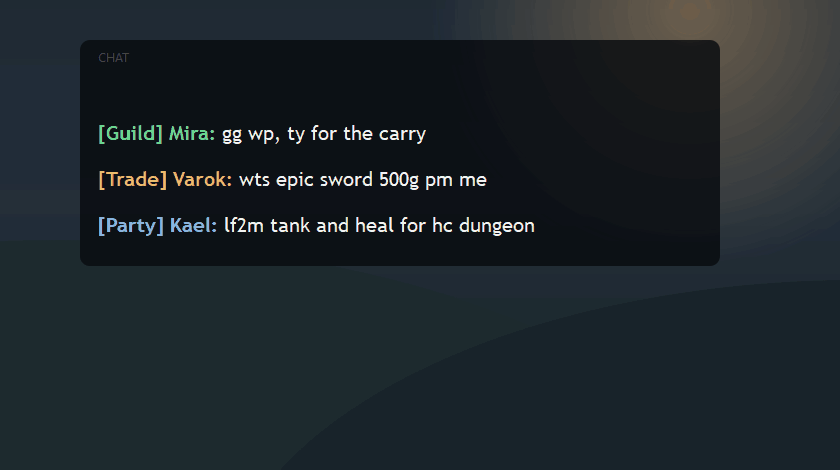
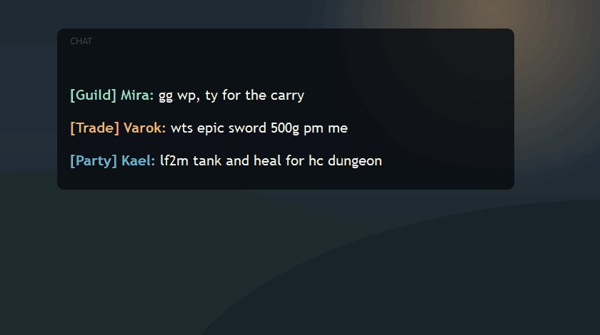
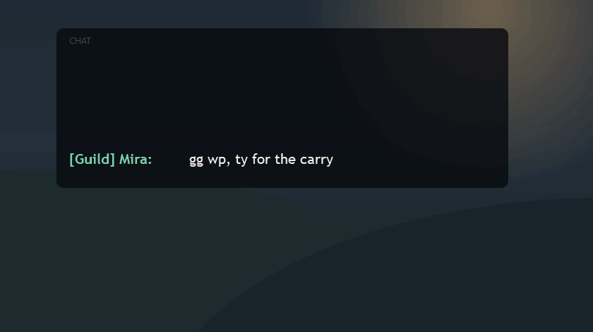
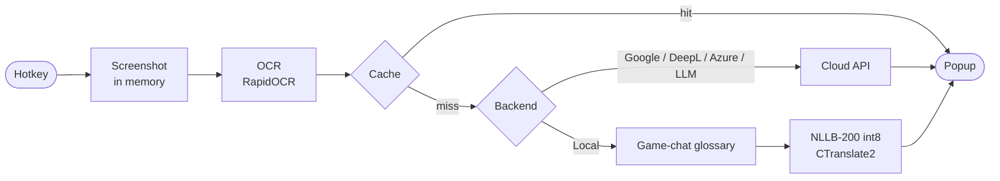
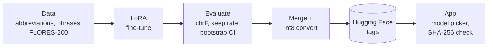

# 🌐 Translator Overlay

[](https://github.com/Vrihe/Overlay-Translator/actions/workflows/ci.yml)
[](https://github.com/Vrihe/Overlay-Translator/actions/workflows/ci.yml?query=branch%3Amain)
[](https://vrihe.github.io/Overlay-Translator/)

**Translate any text on your screen with one hotkey.** Select a game chat, a stream, a program
without a translation — the translation appears in a popup right next to it. Works without an API
key, and can run fully offline with a local model tuned for game chat (`wts`, `lf2m`, `gg`).

<p align="center">
  
</p>

| Trade chat, offline | Live mode: new messages are translated as they arrive |
|---|---|
|  |  |

## Install in 3 steps

1. **Download** `TranslatorOverlay-Setup-<version>.exe` from the
   [latest release](https://github.com/Vrihe/Overlay-Translator/releases/latest) and run it
   (no administrator rights needed).
2. **Pick a mode** in the first-run wizard: online without a key, an LLM with your key, or offline
   (downloads the local model).
3. **Press `Ctrl+Shift+R`** and drag over any text. Settings: `Ctrl+Shift+O`.

Windows 10/11, 64-bit. Running from source, building, configuration and the model are covered in
the [documentation](https://vrihe.github.io/Overlay-Translator/) (also in [`docs/`](docs/index.md)).

---

## Translation modes

| Mode | Key needed | Offline | Good for |
|---|---|---|---|
| **Google Translate** (default) | No | No | Everyday use, many languages |
| **DeepL** / **Azure Translator** | Your key | No | When you already use DeepL or Azure (both have free tiers) |
| **LLM** — OpenRouter (free models) or Anthropic | Your key | No | Context-aware translation with domain profiles, streaming output |
| **Local NLLB-200** | No | **Yes** | Privacy, no internet, game-chat slang; ~1 s per line on a CPU, faster on an NVIDIA GPU |

Also: saved screen regions with their own hotkeys, **live mode** that re-translates a region when
it changes (stream chats), translation history, read-aloud, an interface in English and Russian,
and automatic updates.

## How it works



The local model is NLLB-200-distilled-600M, fine-tuned with LoRA on game-chat data. Every version
goes through the same loop, with release criteria fixed before training:



| Model | General chrF | Abbreviations kept | Notes |
|---|---:|---:|---|
| `v0-base` | 55.65 | 47 % | The original model, int8 |
| `v1-abbr` | 57.41 | 93 % | ~100 chat abbreviations |
| `v2-game` | 57.78 | 96 % | Larger game glossary |

Details: [How it works](docs/how-it-works.md), [Training](docs/training.md),
[Reproducing experiments](docs/experiments.md).

## Privacy

- With a cloud backend the recognised text goes to that provider (Google, DeepL, Azure, OpenRouter
  or Anthropic). **Free OpenRouter models may log prompts.** Do not translate passwords that way.
- **The local model never touches the network**: screen capture, OCR and translation stay on your
  computer.
- Screenshots are never saved. The text is never written to the logs (only its length). The
  history database keeps your last 500 translations; clear it on the History page.
- No telemetry, no account. API keys are stored in Windows Credential Manager.

Everything that is sent or stored: [Privacy](docs/privacy.md).

## FAQ

**No GPU?** Everything works on the CPU; a GPU only speeds up OCR and the local model.

**SmartScreen or antivirus warning?** The installer is not code-signed yet, and the global hotkey
uses a keyboard hook. Check the file's SHA-256 against the release notes, then **More info → Run
anyway**.

**Hotkey ignored in a game?** Windows does not pass keys from a program running as Administrator.
Start Translator Overlay as Administrator only for such programs, or change the hotkey if another
app took it.

More answers: [FAQ](docs/faq.md).

## Limitations

- **Windows only** (10 2004 or newer for all features).
- OCR reads **Latin and Cyrillic** scripts only.
- Auto-detection of the source language is unreliable on very short lines (1–3 words); set a fixed
  source language in Settings if it guesses wrong.
- The local model: no streaming, no domain profiles, and it still leaves some ordinary words
  untranslated in short lines. GPU speed-up needs an NVIDIA GPU and cuBLAS for CUDA 12.
- The model license (CC-BY-NC-4.0) allows **non-commercial use only**.

---

## For developers

```powershell
git clone https://github.com/Vrihe/Overlay-Translator.git
cd Overlay-Translator
install.bat                                      # .venv + requirements.txt
.venv\Scripts\pip install -r requirements-dev.txt
.venv\Scripts\python -m pytest tests/            # tests
run.bat --console                                # the app with a visible log
```

| Topic | Where |
|---|---|
| Installing from source, building the app and the installer | [Installation](docs/installation.md) |
| Settings, `.env` variables, data locations | [Configuration](docs/configuration.md) |
| The local model: versions, download, GPU | [Local offline model](docs/local-model.md) |
| Tests, CI, the docs site | [Development](docs/development.md) |
| Module map, data flow, known problems | [ARCHITECTURE.md](ARCHITECTURE.md) |
| Plan: local model (part A) and the rest (part B) | [ROADMAP.md](ROADMAP.md) |
| How to contribute | [CONTRIBUTING.md](CONTRIBUTING.md), [CODE_OF_CONDUCT.md](CODE_OF_CONDUCT.md) |

### Project structure

```
Overlay-Translator/
├── main.py              # Entry point — tray, hotkeys, pipeline orchestration
├── config.py            # Config facade: settings.json values + .env overrides
├── capture/             # Screen capture (mss) and live region monitoring
├── ocr/                 # RapidOCR engine, optional HSV filter
├── overlay/             # Fullscreen region-selection overlay
├── translate/           # Backend dispatcher; Google, DeepL, Azure, LLM and NLLB clients;
│                        # language detection, game-chat glossary, domain profiles
├── cache/               # SQLite translation cache and history
├── settings/            # API keys (keyring), settings.json, hotkeys, region presets
├── ui/                  # Main window, settings, result popup, first-run wizard, theme
├── history/ i18n/       # History page, Russian / English interface strings
├── tray/ tts/ updater/  # Tray icon, text-to-speech, update check and install
├── scripts/             # Model download, NLLB smoke test, evaluation helpers
├── training/            # NLLB LoRA fine-tuning pipeline (separate venv)
├── docs/                # Documentation site (MkDocs) and training reports
├── installer/           # Inno Setup script
└── tests/
```

### Tech stack

| Component | Technology |
|---|---|
| UI, overlay, tray | PyQt5 |
| Screen capture | mss |
| OCR | RapidOCR (PP-OCRv6 det + PP-OCRv5 rec) on ONNX Runtime with DirectML |
| Cloud translation | Google Translate, DeepL, Azure Translator, OpenRouter, Anthropic |
| Offline translation | NLLB-200-distilled-600M, LoRA fine-tune, CTranslate2 int8 (optional CUDA via `nvidia-cublas-cu12`) |
| Cache and history | SQLite |
| Keys | keyring (Windows Credential Manager) |
| Language detection | langid + script heuristic |
| Hotkeys | keyboard |
| Packaging | PyInstaller, Inno Setup |

## License

The source code is released under the [MIT License](LICENSE).

The optional offline NLLB-200 model and every build made from it are licensed separately under
**CC-BY-NC-4.0** (non-commercial use only). See [MODEL_LICENSE.md](MODEL_LICENSE.md).
