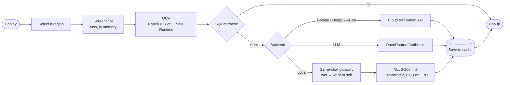
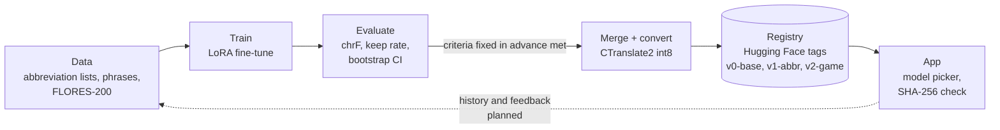

# How it works

## Translation pipeline

A hotkey press starts one pass through the pipeline. Everything up to the translation step
runs on your machine; only the cloud backends send the recognised text out.

1. **Select.** A global hotkey (`Ctrl+Shift+R` by default) opens a transparent overlay over all
   monitors; you drag a rectangle. Saved region presets skip this step, and live mode repeats the
   pass for a region on a timer.
2. **Capture and OCR.** The region is captured with `mss` into memory (nothing is written to disk)
   and recognised by RapidOCR: PP-OCR detection plus a Latin or East Slavic recognition model, on
   the GPU through DirectML when one is available.
3. **Cache.** A two-level cache (in-memory LRU, then SQLite) returns repeated lines instantly.
   Entries are kept per backend, so local output never mixes with cloud output.
4. **Translate.** The backend chosen in Settings runs:
    - **Google Translate** (default, no key), **DeepL** or **Azure** — the provider also detects the
      source language;
    - **LLM** through OpenRouter or Anthropic, with domain profiles (prompt + examples) and streaming;
    - **Local NLLB-200** — game-chat abbreviations are expanded and names are masked by a glossary
      first, then the CTranslate2 int8 model translates offline. If the model is missing, the request
      falls back to the API and the popup says why.
5. **Show.** The popup appears next to the region. It is excluded from screen capture, so the app's
   own OCR and live mode never read it back.

The module-level map and the exact call graph are in
[ARCHITECTURE.md](https://github.com/Vrihe/Overlay-Translator/blob/main/ARCHITECTURE.md).

## Model lifecycle (MLOps)

The local model is NLLB-200-distilled-600M fine-tuned with LoRA for game chat. Each version goes
through the same loop:

| Step | Where |
|---|---|
| Data | `training/prepare_abbreviations.py`, `abbr_phrases.py`, `game_abbreviations.py`, `translate_phrases.py`, `build_dataset*.py` |
| Train | `training/finetune_lora.py` (separate venv, CUDA) |
| Evaluate | `training/evaluate.py`: chrF for abbreviation and general pairs, keep rate, paired bootstrap CI against the previous version |
| Package | `training/merge_lora.py`, then `ct2-transformers-converter --quantization int8` |
| Registry | [Alhite/overlay-translator-nllb-int8](https://huggingface.co/Alhite/overlay-translator-nllb-int8), one git tag per version |
| App | Settings → Local model lists the tags, downloads a build and checks every file's SHA-256 |

What is automated and what is still manual is tracked in the
[roadmap](https://github.com/Vrihe/Overlay-Translator/blob/main/ROADMAP.md) (part A). How each
version was trained and scored: [Training](training.md) and [Reproducing experiments](experiments.md).
