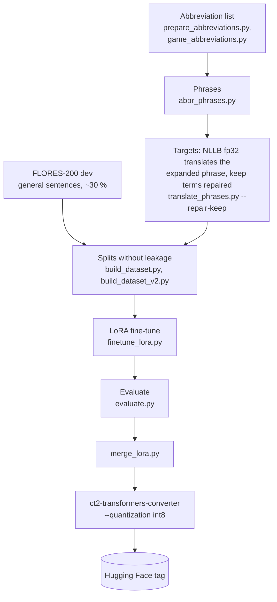

# Training

The local model is NLLB-200-distilled-600M with a LoRA adapter trained on game-chat
abbreviations, merged and converted to CTranslate2 int8. This page is the overview; the detailed
write-ups with every decision are [Fine-tune v1](finetune_v1_process.md) and
[Fine-tune v2](finetune_v2_process.md).

## Environment

Training uses its own venv, because it needs a CUDA build of PyTorch while the app venv does not
have PyTorch at all.

```powershell
py -3.13 -m venv .venv-train
.venv-train\Scripts\pip install torch --index-url https://download.pytorch.org/whl/cu130
.venv-train\Scripts\pip install -r requirements-train.txt
.venv-train\Scripts\python -c "import torch; print(torch.cuda.is_available())"
```

Pick the `cuXXX` tag that matches your NVIDIA driver ([pytorch.org](https://pytorch.org/get-started/locally/)).
If the PyTorch index is unreachable, install a torch wheel from a file. The v1 and v2 runs used
torch 2.14 + cu130, transformers 5.17, peft 0.21 and ctranslate2 4.8.2 on an RTX 3060 Ti (8 GB):
v1 trained in 18 minutes, v2 (~20× more abbreviations) in about two hours.

The data step also needs access to [`facebook/flores`](https://huggingface.co/datasets/facebook/flores)
(gated, approved automatically) with the FLORES-200 `dev` parquet files in `data/raw/flores200/`.

`data/`, `models/`, `checkpoints/`, `.venv-train/` and `.train-cache/` are git-ignored: only the
scripts, the hand-written phrase lists and the docs are tracked.

## Pipeline



| Script | Does |
|---|---|
| `training/prepare_abbreviations.py` | Filters and ranks a public SMS-abbreviation list for manual selection (keep or translate) |
| `training/abbr_phrases.py` | Turns the hand-written `training/abbr_phrases.txt` into phrase pairs: the short form and the expanded form |
| `training/game_abbreviations.py` | v2: curates the game-chat glossary (needs `wordfreq` in the app venv) |
| `training/translate_phrases.py` | Translates the *expanded* phrases with NLLB fp32 into every target language; `--repair-keep` restores terms that must stay verbatim (`gg`, `pvp`) |
| `training/build_dataset.py` | v1 splits: by abbreviation (held-out experiment) or by phrase (release model), plus disjoint FLORES pools |
| `training/build_dataset_v2.py` | v2 splits, reusing the v1 FLORES pools so general scores stay comparable |
| `training/finetune_lora.py` | LoRA on the attention projections, bf16, best checkpoint by validation loss; writes `run_config.json` |
| `training/evaluate.py` | chrF for abbreviation and general pairs, keep rate, per-language scores, paired bootstrap 95 % CI against the first system |
| `training/gold_eval.py` | Scores systems on the hand-checked gold set (see below): chrF per category and language, keep rate, wrong-expansion rate, OCR-noise drop, mean / 95 % CI over training seeds |
| `training/quality_gate.py` | Quality gate: compares a candidate with the stable build on the gold set, thresholds in `configs/quality_gate.json` (see below) |
| `training/tracking.py` | Optional MLflow logging used by `finetune_lora.py`, `evaluate.py` and `gold_eval.py` (see below) |
| `training/merge_lora.py` | Merges the adapter into the base weights for conversion |

## One command per stage

Each published version has a config in `configs/train/` (`v1.yaml`, `v2.yaml`) with the data
steps, the fine-tune hyperparameters and the merge, convert and eval outputs.
`training/pipeline.py` runs it stage by stage:

```powershell
.venv-train\Scripts\python training\pipeline.py all   --config configs\train\v2.yaml --name v2-repro
.venv-train\Scripts\python training\pipeline.py train --config configs\train\v2.yaml --name v2-repro
.venv-train\Scripts\python training\pipeline.py all   --config configs\train\v2.yaml --dry-run
```

Stages are `data`, `train`, `merge`, `convert` and `eval`, and `all` runs them in that order.
`--name` renames the run, and every `{name}` path in the config follows it, so a rerun never
overwrites a published checkpoint or model. Stages that would overwrite one refuse to run
without `--force`. `translate_phrases.py` resumes from its output file, so the `data` stage first
deletes the files listed in `data.clean` (only paths under `data/` are allowed) and rebuilds
the targets from scratch. Options on the `finetune_lora.py` command line win over the config, for
example `--max-steps 50` for a trial. Set `NLLB_BASE_MODEL_DIR` when the fp32 checkpoint is
not in `models/`.

`precision` in the config is `bf16` by default (RTX 30xx and newer, A100, L4). On a GPU without
bf16, such as the free Colab T4, use `--precision fp16`. Expect slightly different numbers then.

On Linux or WSL the same stages are `make <stage> CONFIG=configs/train/v2.yaml NAME=v2-repro`.
`Dockerfile.train` builds a training image with the pinned libraries; the header of the file has
the `docker run` command, with `models/`, `data/` and `checkpoints/` mounted from the host.

Every run writes `checkpoints/<run>/run_config.json` with a `provenance` block: the git commit
and whether the tree was dirty, the versions of torch, transformers, peft, ctranslate2 and the
other libraries that change results, the sha256 of `train.jsonl` + `val.jsonl`, and the path
and sha256 of the config.

## Data versioning (DVC)

`dvc.yaml` describes the same stages for DVC, from the phrase lists to the scores of each
version, so DVC knows what is stale and rebuilds only that. Data under `data/` is cached and
pushed to a Google Drive remote (`gdrive://root/overlay-translator-dvc`). Checkpoints and models
are only hashed (`cache: false`), because they are large and the shipped builds are on Hugging
Face. `data/raw` (FLORES-200 dev, the public SMS list) and `data/processed_v2` (the frozen test
files of the published v2 scores) are tracked by `data/*.dvc` pointer files.
`data/history_pairs.jsonl` is exported screen text and is never tracked or pushed.

```powershell
.venv-train\Scripts\activate
dvc pull              # first time: a browser window asks for Google Drive access
dvc status            # which stages are stale
dvc repro v2_eval     # rebuild what changed, up to the v2 scores
dvc push              # upload new data versions
```

The DVC stages use the run names `v1-repro` and `v2-repro`, so they never overwrite the
checkpoints of the published runs. Outputs built outside DVC (for example by
`training/pipeline.py`) are recorded with `dvc commit -f`. That command also copies the
`cache: false` models into the local cache, so run `dvc gc -w -f` afterwards to drop those
copies; the workspace files stay.

## Rules the runs follow

- **Criteria fixed before training.** Each version has release criteria written down before the
  run (for example "general chrF not below the previous version − 1", "keep rate ≥ 90 %"). A
  version that misses one is either not released or released with the failure documented.
- **No leakage.** Test abbreviations never appear in train or validation (held-out experiment), and
  FLORES sentences are split into fixed, disjoint pools. Both properties are covered by
  `tests/test_training_data.py`.
- **Score what ships.** The int8 CTranslate2 build is evaluated on the CPU exactly as the app runs
  it, not only the fp32 checkpoint.
- **GPU budget.** Long runs cap GPU memory and duty cycle (`--gpu-mem-fraction`, `--gpu-duty`) so
  the machine stays usable.

## Experiment tracking (MLflow / DagsHub)

`finetune_lora.py`, `evaluate.py` and `gold_eval.py score` log each finished run through
`training/tracking.py`: parameters, metrics, training curves, git sha, dataset / gold SHA-256 and the
summary JSON. Experiments are named `finetune`, `eval` and `gold-eval`; one run per model or system.
Text from screens, gold rows and hypotheses are never logged, and path parameters keep only their
last component.

```powershell
$env:MLFLOW_TRACKING_URI      = "https://dagshub.com/<user>/<repo>.mlflow"
$env:MLFLOW_TRACKING_USERNAME = "<user>"
$env:MLFLOW_TRACKING_PASSWORD = "<DagsHub token>"   # keep it in the environment, never in git
```

Without `MLFLOW_TRACKING_URI` runs go to a local store, `mlruns/mlflow.db` (git-ignored; browse it
with `mlflow ui --backend-store-uri sqlite:///mlruns/mlflow.db`). `OVERLAY_TRACKING=off` disables
tracking. A missing `mlflow` package or an unreachable server only prints a warning; training and
evaluation continue.

## Quality gate

A candidate build may become `stable` only if `training/quality_gate.py` passes on the gold set. The
gate reads one `gold_eval.py score` summary that holds both the candidate and the current stable build
and checks, with the thresholds in `configs/quality_gate.json`:

| Check | Rule (default) |
|---|---|
| rows | gold set has at least 300 lines |
| keep rate | candidate >= 90 % |
| overall chrF | drop against stable <= 1.0 |
| ordinary-word chrF | drop against stable <= 2.0 |
| wrong expansions | candidate <= 10 % |
| OCR noise | chrF lost on noisy input grows by <= 3.0 |

A metric missing from the summary fails its check. Set the thresholds before looking at results.

```bash
python training/gold_eval.py score data/gold/gold.jsonl candidate=ct2:models/v3 baseline=ct2:models/v2-game --out checkpoints/gold
python training/quality_gate.py checkpoints/gold/summary.json --candidate candidate --baseline baseline --report checkpoints/gold/gate.md
```

Exit code 0 means pass, 1 means a check failed, 2 means a system name is not in the summary. The
manual workflow `.github/workflows/model-eval.yml` runs the same steps on a CPU runner (both builds
as CTranslate2 int8), writes the report to the job summary and uploads `gate.md` and `summary.json`.
It needs the repository secret `GDRIVE_CREDENTIALS_DATA` (the gold set is DVC-tracked, never in git).
The workflow publishes nothing: moving the pinned revision or the manifest is a reviewed pull request.

## Gold set (hand-checked evaluation)

`evaluate.py` scores against references produced by NLLB itself, so it measures agreement with
the base model, not correctness. `training/gold_eval.py` scores against translations a person
wrote and checked. The set lives in `data/gold/gold.jsonl` (DVC-tracked, never in git, never
used for training); one JSON object per line:

| Field | Meaning |
|---|---|
| `id`, `src`, `lang`, `ref` | unique id, English source, target language (`ru`, `uk`, `pl`, …), hand-checked translation |
| `category` | `abbr`, `keep`, `ordinary`, `mixed` or `ocr_noise` |
| `keep_terms` | optional: terms that must survive verbatim (feeds the keep rate) |
| `wrong_expansions` | optional: substrings that count as a wrong expansion of an abbreviation |
| `noisy_src` | optional: the same line as OCR would misread it (feeds the OCR-noise drop) |

Lines must be anonymised: no nicknames, no screen text of other people.
`training/gold_example.jsonl` shows the format with five synthetic rows (one per category); it is not
evaluation data. Check your file as you go with `python training/gold_eval.py validate data/gold/gold.jsonl`.

```bash
python training/gold_eval.py validate data/gold/gold.jsonl --train data/processed_v2/train.jsonl
python training/gold_eval.py noise data/gold/gold.jsonl --out data/gold/gold_noisy.jsonl   # synthetic OCR-style noisy_src
python training/gold_eval.py score data/gold/gold.jsonl v0-base=ct2:models/nllb-v0-base v2-game=ct2:models/nllb-v2-game
python training/gold_eval.py aggregate checkpoints/gold_s1/summary.json checkpoints/gold_s2/summary.json checkpoints/gold_s3/summary.json
```

`validate` checks the schema, prints counts per category and the file's SHA-256 (stored in every
summary, so a score names its exact test set), warns below 300 rows, and fails when a gold source
also appears in a training file. `aggregate` refuses summaries scored on different gold sets and
reports mean, standard deviation and a 95 % CI (Student t) over at least three training seeds.
The shipping decision is taken on these numbers, not on the self-distilled ones.

## Training a new version

1. Prepare data with the scripts above into a new `data/processed_<name>/`.
2. Run a short trial first: `finetune_lora.py --max-steps 50 --run-name trial --data-dir …`.
3. Train: `finetune_lora.py --run-name <name> --data-dir … --epochs 5`.
4. Evaluate against the current release on the same test set, check the criteria.
5. Merge, convert to int8, smoke-test with `scripts/test_nllb_translation.py`, then evaluate the
   int8 build too.
6. Upload the folder to the Hugging Face repo and tag it (`v3-…`); the app's model picker lists
   the new tag automatically.

The exact commands of the published runs are on [Reproducing experiments](experiments.md).

## Monitoring the offline model

`scripts/monitor_report.py` reads the app's translation history (read-only) and prints, for the local
model's rows: the share of lines with an unknown token (a slang-looking word outside the glossary),
the top lost keep terms and a drift verdict. Exit code 2 means the unknown-token share of the last
`--window-days` (default 30) grew by more than `--threshold` points (default 5) against the earlier rows,
with at least 50 rows in each period; that is the signal to update the glossary or retrain.

```bash
python scripts/monitor_report.py --window-days 14 --json report.json
python scripts/monitor_report.py --show-tokens   # also lists the tokens: they are fragments of screen text
```

The history keeps no latency, so the report has no latency distribution. Unknown tokens are a heuristic
(a letter/digit mix or a short vowelless word); `--vocab words.txt` marks ordinary words as known.
