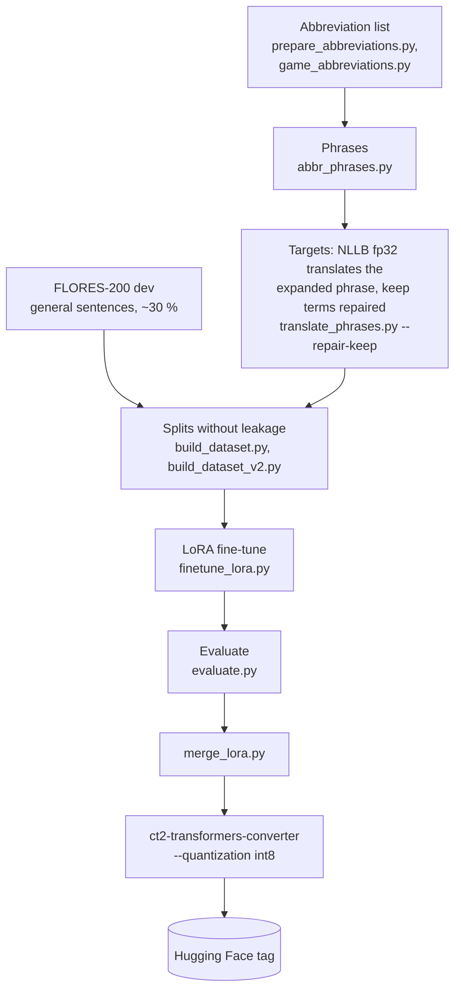

# Training

The local model is NLLB-200-distilled-600M with a LoRA adapter trained on game-chat
abbreviations, merged and converted to CTranslate2 int8. This page is the overview; the detailed
write-ups with every decision are [Fine-tune v1](finetune_v1_process.md) and
[Fine-tune v2](finetune_v2_process.md).

## Environment

Training uses its own venv, because it needs a CUDA build of PyTorch while the app venv does not
have PyTorch at all.

```powershell
py -3.13 -m venv .venv-train
.venv-train\Scripts\pip install torch --index-url https://download.pytorch.org/whl/cu130
.venv-train\Scripts\pip install -r requirements-train.txt
.venv-train\Scripts\python -c "import torch; print(torch.cuda.is_available())"
```

Pick the `cuXXX` tag that matches your NVIDIA driver ([pytorch.org](https://pytorch.org/get-started/locally/)).
If the PyTorch index is unreachable, install a torch wheel from a file. The v1 and v2 runs used
torch 2.14 + cu130, transformers 5.17, peft 0.21 and ctranslate2 4.8.2 on an RTX 3060 Ti (8 GB):
v1 trained in 18 minutes, v2 (~20× more abbreviations) in about two hours.

The data step also needs access to [`facebook/flores`](https://huggingface.co/datasets/facebook/flores)
(gated, approved automatically) with the FLORES-200 `dev` parquet files in `data/raw/flores200/`.

`data/`, `models/`, `checkpoints/`, `.venv-train/` and `.train-cache/` are git-ignored: only the
scripts, the hand-written phrase lists and the docs are tracked.

## Pipeline



| Script | Does |
|---|---|
| `training/prepare_abbreviations.py` | Filters and ranks a public SMS-abbreviation list for manual selection (keep or translate) |
| `training/abbr_phrases.py` | Turns the hand-written `training/abbr_phrases.txt` into phrase pairs: the short form and the expanded form |
| `training/game_abbreviations.py` | v2: curates the game-chat glossary (needs `wordfreq` in the app venv) |
| `training/translate_phrases.py` | Translates the *expanded* phrases with NLLB fp32 into every target language; `--repair-keep` restores terms that must stay verbatim (`gg`, `pvp`) |
| `training/build_dataset.py` | v1 splits: by abbreviation (held-out experiment) or by phrase (release model), plus disjoint FLORES pools |
| `training/build_dataset_v2.py` | v2 splits, reusing the v1 FLORES pools so general scores stay comparable |
| `training/finetune_lora.py` | LoRA on the attention projections, bf16, best checkpoint by validation loss; writes `run_config.json` |
| `training/evaluate.py` | chrF for abbreviation and general pairs, keep rate, per-language scores, paired bootstrap 95 % CI against the first system |
| `training/merge_lora.py` | Merges the adapter into the base weights for conversion |

## Rules the runs follow

- **Criteria fixed before training.** Each version has release criteria written down before the
  run (for example "general chrF not below the previous version − 1", "keep rate ≥ 90 %"). A
  version that misses one is either not released or released with the failure documented.
- **No leakage.** Test abbreviations never appear in train or validation (held-out experiment), and
  FLORES sentences are split into fixed, disjoint pools. Both properties are covered by
  `tests/test_training_data.py`.
- **Score what ships.** The int8 CTranslate2 build is evaluated on the CPU exactly as the app runs
  it, not only the fp32 checkpoint.
- **GPU budget.** Long runs cap GPU memory and duty cycle (`--gpu-mem-fraction`, `--gpu-duty`) so
  the machine stays usable.

## Training a new version

1. Prepare data with the scripts above into a new `data/processed_<name>/`.
2. Run a short trial first: `finetune_lora.py --max-steps 50 --run-name trial --data-dir …`.
3. Train: `finetune_lora.py --run-name <name> --data-dir … --epochs 5`.
4. Evaluate against the current release on the same test set, check the criteria.
5. Merge, convert to int8, smoke-test with `scripts/test_nllb_translation.py`, then evaluate the
   int8 build too.
6. Upload the folder to the Hugging Face repo and tag it (`v3-…`); the app's model picker lists
   the new tag automatically.

The exact commands of the published runs are on [Reproducing experiments](experiments.md).
